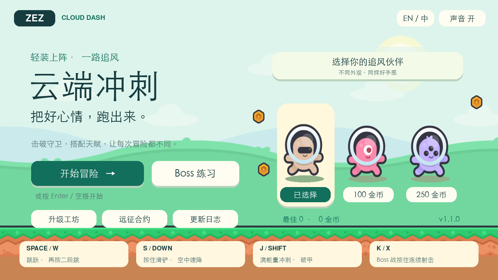
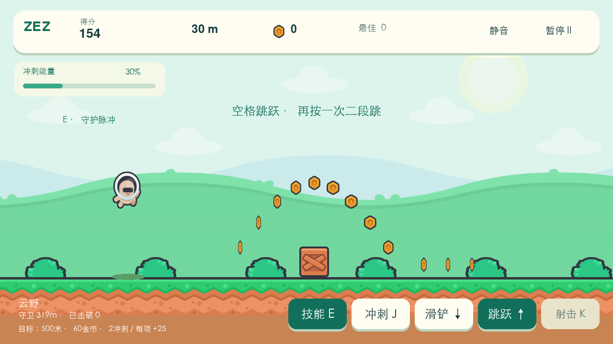
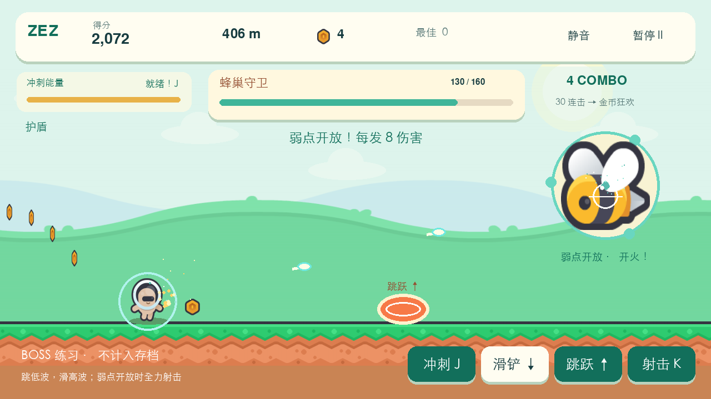
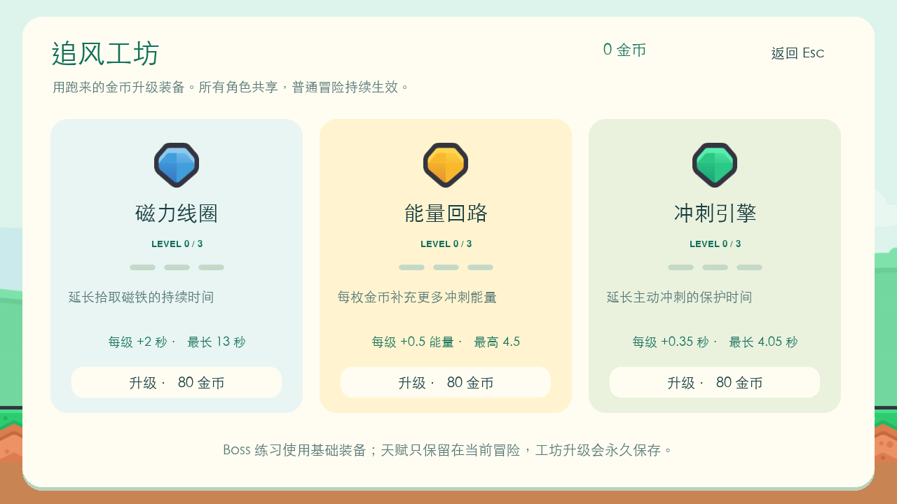
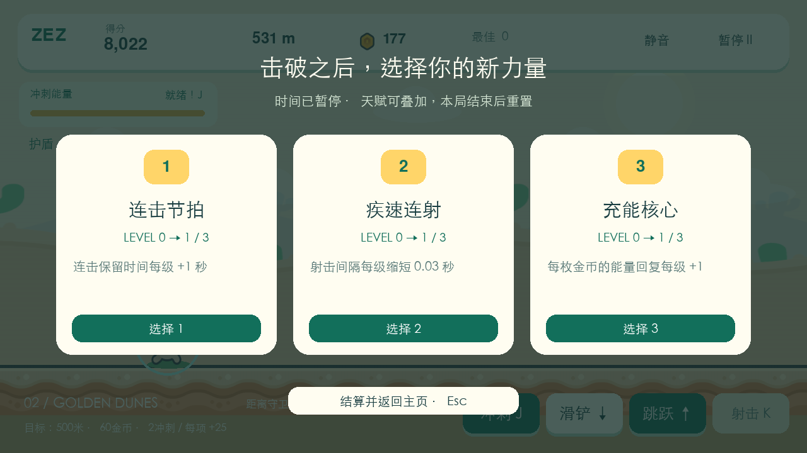
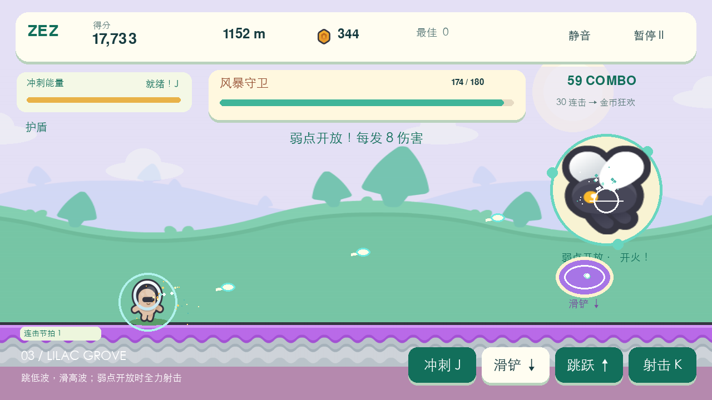

# ZEZ · 云端冲刺 / Cloud Dash

一个用 Python + Pygame CE 制作的横版跑酷游戏。二段跳越过木箱，滑铲穿过飞行障碍，积累连击开启金币狂欢；遇到蜂巢守卫时，躲开能量波，抓住弱点射击，再带着奖励继续跑。

**v1.1.0 · 2026-10-19**：Boss 后选天赋、金币升级工坊、累计远征合约，以及交替出现的蜂巢 / 风暴守卫。[更新日志](python-games/ZEZ/CHANGELOG.md) · [机制对比与设计说明](python-games/ZEZ/docs/design-notes.md)



## 开始游戏

先安装 **Python 3.9 或更新版本**，下载或克隆本仓库，打开 `python-games/ZEZ`：

- **macOS**：双击 `play.command`。
- **Windows**：双击 `play.bat`。
- 首次启动会创建 `.venv` 并联网安装依赖；安装成功后可离线游玩。

也可以在终端运行：

```bash
git clone https://github.com/Majino12/game.git
cd game/python-games/ZEZ
python3 -m venv .venv
.venv/bin/python -m pip install -r requirements.txt
.venv/bin/python main.py
```

Windows 的手动安装命令、存档位置和测试方式见 [完整说明](python-games/ZEZ/README.md)。资源路径与当前工作目录无关，也可从仓库根目录运行 `python python-games/ZEZ/main.py`。

## 这次跑什么

- **跳跃、二段跳、滑铲与空中速降**：木箱、尖刺、飞行障碍采用有间距的片段，速度逐步增加。
- **金币与连击**：金币得分最高 5 倍；30 连击可开启 8 秒金币狂欢，自动吸币并清除障碍，重复触发有冷却。
- **道具和主动冲刺**：磁铁吸币、护盾挡伤，能量充满后加速冲刺，基础时长 3 秒。
- **两类守卫 Boss 战**：首次在 350 米后登场，之后蜂巢与风暴模式交替；跳低波、滑高波，按住 `K` / `X` 射击弱点。后续守卫血量逐步增加，半血以下节奏加快。
- **Boss 后选天赋**：击败守卫获得 50 金币、500 分、护盾和满能量，再从最多三项天赋中选一项，强化本局的跳跃、射击、吸币、充能或连击。继续跑 600 米后迎接下一只；天赋随本局结束清空。
- **升级工坊与远征合约**：金币可永久升级磁铁、充能和冲刺，每项最高三级；累计距离、金币和 Boss 击破数还能反复完成合约，结算自动发奖。
- **免费 Boss 练习**：自带护盾和满能量，不应用工坊升级，不产生钱包、合约和纪录收益。
- **三个外观角色**：奶油免费，莓莓 100 金币，星云 250 金币；能力相同。
- **每局三个目标**：达到 500 米、收集 60 金币、使用 2 次冲刺，每完成一项结算奖励 25 金币。
- **本地记录**：保存最高分、最远距离、金币、角色及声音和语言设置；支持中英文、暂停、全屏和窗口缩放。



| 操作 | 按键 |
| --- | --- |
| 跳跃 / 二段跳 | `Space` / `W` / `↑` |
| 按住滑铲 / 空中速降 | `S` / `↓` / `Ctrl` |
| 满能量冲刺 | `J` / `Shift` |
| Boss 战按住连续射击 | `K` / `X` |
| 天赋页选择第 1 / 2 / 3 项 | `1` / `2` / `3`，或鼠标点击 |
| 暂停 / 继续 | `Esc` / `P` |
| 工坊、合约、更新说明返回菜单 | `Esc` |
| 声音 / 中英文 / 全屏 | `M` / `L` / `F11` |



| 升级工坊 | 战后天赋 | 风暴守卫 |
| --- | --- | --- |
|  |  |  |

## 项目与素材

游戏位于 [`python-games/ZEZ`](python-games/ZEZ)。当前玩法结合跑酷、连击、冲刺与蜂巢守卫战；旧版传送门、天赋及战斗实现可从本仓库 Git 历史查找。

新素材来自 [Kenney New Platformer Pack](https://kenney.nl/assets/new-platformer-pack)，随项目收录 **103 个 CC0 图片和音效文件**。[素材清单](python-games/ZEZ/assets/manifest.json)记录来源、尺寸和 SHA-256；[原始许可证](python-games/ZEZ/assets/KENNEY_LICENSE.txt)一并保留。背景音乐由 `runner/assets.py` 的 `create_music()` 在本地合成。

本版已在本地通过 **85 项自动测试**。[GitHub Actions](.github/workflows/test.yml) 配置了 Linux、Python 3.9 / 3.12 的自动测试，以及菜单、跑酷、Boss、暂停、结算、工坊、合约、天赋、更新说明九个场景的无窗口渲染检查，另覆盖 Boss 入场后的战斗画面。

## English

**ZEZ: Cloud Dash** is a Python/Pygame CE endless runner with double jumps, slides, coins, magnets, shields and energy dashes. Build a 30-coin combo, complete run goals and unlock cosmetic runners. The Hive Guardian arrives after 350 metres: jump over low waves, slide under high waves, and hold `K` / `X` to fire at its weak point. Defeat it for coins, score, a shield and full energy; the next encounter is 600 metres after the previous defeat. Free Boss Practice is available from the menu and does not change saved records or the wallet.

Version 1.1.0 adds a choice of temporary perks after each boss, permanent Workshop upgrades, repeatable career contracts, and alternating Hive / Storm Guardians. Perks reset each run; purchased upgrades and contract progress remain in the local save. Practice does not apply Workshop upgrades or earn saved rewards. See the [changelog](python-games/ZEZ/CHANGELOG.md).

Requires Python 3.9+. Open `python-games/ZEZ/play.command` on macOS or `play.bat` on Windows. The first launch installs dependencies; later launches work offline. See the [game README](python-games/ZEZ/README.md) for controls, saves and testing. Kenney artwork and sound effects are CC0; the background music is synthesized locally.
