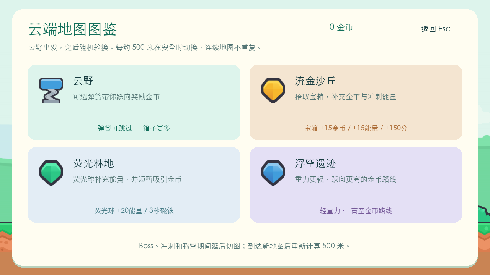
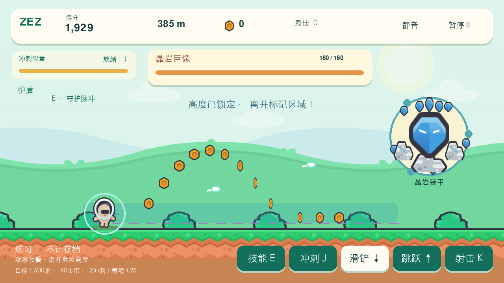

# ZEZ · 云端冲刺 / Cloud Dash

跳过木箱，滑过飞行障碍，追着金币跑向下一片天空；守卫出现时，一边躲避攻击一边射击，击破后继续冒险。游戏围绕二段跳、滑铲、连击奖励、主动冲刺与 Boss 战展开，使用 Python + Pygame CE，支持中英文界面。

当前版本：**1.2.0（2026-10-19）**。新增角色主动技能、四张不同机制地图与三类守卫；保留本局天赋、永久工坊升级和累计合约。完整变化见[更新日志](CHANGELOG.md)，同类机制研究与设计取舍见[设计说明](docs/design-notes.md)。菜单也可查看游戏内更新说明。


| v1.2 地图图鉴 | v1.2 晶岩巨像 |
| --- | --- |
|  |  |

## 安装与启动

需要 **Python 3.9+** 和桌面图形环境。唯一运行依赖为 `pygame-ce==2.5.6`，已固定在 [`requirements.txt`](requirements.txt)。

**macOS**：双击 [`play.command`](play.command)。也可在终端执行 `./play.command`；如下载后的文件没有执行权限，先运行 `chmod +x play.command`。

**Windows**：双击 [`play.bat`](play.bat)。脚本优先使用 Python 启动器 `py -3`，没有启动器时尝试 `python`。

两个脚本都会在游戏目录创建独立的 `.venv`。首次安装依赖需要联网，安装成功后启动时只检查本地依赖，可以离线游玩。脚本不会自动安装 Python。

手动安装与运行，在本目录执行：

```bash
# macOS / Linux
python3 -m venv .venv
.venv/bin/python -m pip install -r requirements.txt
.venv/bin/python main.py
```

```bat
:: Windows
py -3 -m venv .venv
.venv\Scripts\python.exe -m pip install -r requirements.txt
.venv\Scripts\python.exe main.py
```

图片和音频按源码所在位置加载，支持从任意工作目录通过 `main.py` 的绝对路径启动。例如从仓库根目录运行：

```bash
python-games/ZEZ/.venv/bin/python python-games/ZEZ/main.py
```

默认窗口为 1152 × 648，可调整大小；画面按 1280 × 720 等比例缩放。没有可用中文字体时自动使用英文，安装系统中文字体后可切换中文。无音频设备时仍可游玩。

## 操作

| 按键 | 动作 |
| --- | --- |
| `Enter` / `Space` | 菜单开始；结算后再跑一局 |
| `Space` / `W` / `↑` | 跳跃；空中再次按下为二段跳 |
| 按住 `S` / `↓` / `Ctrl` | 地面滑铲；空中首次按下快速下落 |
| `J` / `Shift` | 能量满时发动冲刺 |
| `E` | 使用当前角色的主动技能，需要冷却就绪 |
| 按住 `K` / `X` | Boss 战中自动瞄准、连续射击 |
| `Esc` / `P` | 游戏中暂停或继续；结算界面返回菜单 |
| `Enter` | 暂停时继续 |
| `1` / `2` / `3` | 天赋页选择对应卡片，也可鼠标点击 |
| `Esc` | 工坊、合约、地图、练习选择、更新说明返回菜单；天赋页结算当前冒险并返回菜单 |
| `M` | 开关声音 |
| `L` | 中英文切换，需要系统中文字体 |
| `F11` | 切换全屏 |

屏幕按钮也支持鼠标操作，滑铲和射击按钮需要按住。窗口失去焦点会自动暂停并清除按住的动作；暂停不消耗技能冷却、道具、奖励或 Boss 阶段时间。

## 玩法与奖励

沿金币弧线起跳，遇到飞行障碍按住滑铲。前段逐步引入不同障碍，随后提高速度；障碍采用有安全间距的片段。二段跳可以补救起跳时机，空中速降可以提前落地。

连续拾取金币可提高金币得分，最高 **5 倍**；基础状态超过 **3 秒** 没有拾取金币，当前连击归零，连击节拍天赋可以延长这段时间。达到 **30 连击** 可进入 **8 秒金币狂欢**，清除障碍并自动吸取可见金币，速度为基础速度的 **1.25 倍**。奖励触发后有冷却，避免奖励期间连续重复开启。

| 道具 / 技能 | 效果 |
| --- | --- |
| 磁铁 | 基础持续 7 秒，可由工坊延长时间、天赋扩大范围 |
| 护盾 | 抵挡一次碰撞，并给 0.9 秒保护 |
| 电池 | 补充 35 点冲刺能量 |
| 主动冲刺 | 能量达到 100 后发动，基础持续 3 秒，工坊可延长；速度为基础速度的 1.55 倍，清除障碍并吸取附近金币 |
| 冲刺 / 狂欢结束 | 恢复基础速度，留出安全距离，并给 0.8 秒保护 |

金币和避开障碍都能补充能量。成绩由距离、金币得分、通过的障碍和 Boss 击破奖励组成；金币得分倍率不会放大结算时存入的钱包金币数量。

每局有三个独立目标：**500 米、60 金币、2 次主动冲刺**。完成一项，结算额外获得 **25 金币**，一局最多奖励 75 金币。

菜单可选择三个角色；基础移动操作一致，各有不同的 `E` 主动技能：

| 角色 | 解锁价格 | `E` 技能 | 冷却 |
| --- | --- | --- | --- |
| 奶油 / Cream | 免费 | **守护脉冲**：获得一次护盾与 1.2 秒保护，清除身边 260 像素内的障碍和敌弹 | 12 秒 |
| 莓莓 / Berry | 100 金币 | **流星跃**：立即向上跃起，恢复后续空中跳跃机会，磁铁时间至少 4 秒，并获得 0.8 秒保护 | 10 秒 |
| 星云 / Nova | 250 金币 | **星环爆发**：清除所有敌弹和前方可见障碍，回复 30 能量，对可攻击的 Boss 造成 35 伤害，并获得 0.5 秒保护 | 14 秒 |

技能不消耗冲刺能量，可在普通跑酷和 Boss 战中使用；画面显示冷却。莓莓起飞后视为已用一次跳跃，仍可接二段跳，有轻翼天赋时还可接三段跳。星云只能伤害装甲预警或弱点阶段的守卫，入场与退场阶段不受伤害。


## 四张地图

每局从**云野**开始；到达 500 米后，等角色落地且没有 Boss、冲刺、狂欢或天赋选择时切图，并清除近处障碍、留出过渡。之后每次切换都从**实际切图位置再计算 500 米**，不会因为延迟切换而连跳地图。首轮走遍其余三张地图，随后每组四张打乱顺序，相邻地图不会相同。

| 地图 | 路线与特殊奖励 |
| --- | --- |
| 云野 / Cloud Meadow | 木箱较常见；可选择踩弹簧跃向 5 枚奖励金币，保留后续空跳机会 |
| 流金沙丘 / Golden Dunes | 尖刺较常见；空中宝箱提供 **15 金币、15 能量和 150 分** |
| 荧光林地 / Glow Grove | 飞行障碍较常见；荧光球回复 **20 能量**，并让磁铁至少持续 **3 秒** |
| 浮空遗迹 / Floating Ruins | 重力由 2100 降为 **1650 像素/秒²**，跳跃币线提高，并出现额外高空金币 |

普通片段每四段安排一次当前地图的特殊奖励；开局先逐步教学障碍，再使用各地图不同的障碍权重。菜单中的**地图图鉴**可查看路线特性。

## 三类守卫

首只守卫在 **350 米**后出现；如果此时仍在主动冲刺或金币狂欢，会等效果结束再入场。入场会清空普通障碍，并给 **2 秒**准备时间。战斗中里程继续增长，普通跑酷片段暂时停止生成。

攻击前会显示路径和动作提示：**低波用跳跃越过，高波用滑铲穿过**。首只为疾风蜂王；之后三种守卫按随机顺序轮换，每组包含各一种，相邻遭遇不会相同。血量从 160 起，每次遭遇增加 20，最高 240。

| 守卫 | 攻击模式与应对 |
| --- | --- |
| 疾风蜂王 / Gale Queen | 低、高单波交替；看清提示后跳跃或滑铲 |
| 风暴守卫 / Storm Guardian | 高、低、低、高循环，每次同一高度连续双波；低波可接二段跳，高波要保持滑铲 |
| 晶岩巨像 / Crystal Colossus | 瞄准弹、低波、高波循环；瞄准弹在预警开始时锁定角色高度，离开标出的危险带即可避开 |

按住 `K` / `X` 或屏幕射击按钮即可连续自动瞄准，基础间隔 0.25 秒，疾速连射天赋可缩短间隔；不必松开射击再跳跃或滑铲。

| 战斗阶段 / 动作 | 规则 |
| --- | --- |
| 装甲预警 | 初始预警 1.35 秒，命中造成 2 点伤害 |
| 弱点开放 | 每次发射能量波后开放 2.5 秒，基础命中伤害 8，可由弱点专注天赋提高 |
| 半血以下 | 下轮预警缩短为 1 秒，能量波加快；弱点期仍为 2.5 秒 |
| 主动冲刺 | 满能量时发动，每次对守卫造成一次 25 点伤害，同时抵挡能量波 |
| 击败守卫 | 本局获得 **50 金币、500 分、护盾和满能量** |

普通冒险击破 Boss 后，退场结束会打开天赋选择页；选好后恢复跑酷，并留出安全过渡。下一只守卫的触发点为**本次击败时的里程 +600 米**。Boss 战中不会触发金币狂欢；击破奖励不增加金币连击。

菜单中的 **Boss 练习**可选择任一守卫，带着护盾和满能量迎战，可使用当前角色的技能，不应用工坊升级。练习免费，击败后结束本次练习，也可立即重试；不提供战后天赋，练习成绩、金币、局数和合约进度均不计入存档。命令行同样支持：

```bash
python main.py --scene practice
python main.py --scene boss --boss-kind crystal
```


## 本局天赋

每次普通冒险击破 Boss，系统会从尚未满级的天赋中随机给出最多三项，按 `1` / `2` / `3` 或点击卡片选择一项。阅读卡片时游戏暂停，选择后立即生效。天赋只保留到本局结束，重新开始冒险会清空。

| 天赋 | 每级效果 | 最高等级 |
| --- | --- | --- |
| 轻翼 | 多一次空中跳跃，从二段跳变为三段跳 | 1 |
| 弱点专注 | Boss 弱点命中伤害 +2 | 3 |
| 充能核心 | 每枚金币回复的冲刺能量 +1 | 3 |
| 疾速连射 | 射击间隔缩短 0.03 秒 | 3 |
| 磁力扩展 | 磁铁与冲刺吸币范围增加 100 像素 | 3 |
| 连击节拍 | 连击保留时间延长 1 秒 | 3 |

未满级项目少于三种时，只显示剩余项目。六种天赋全部满级后，后续 Boss 提供可重复选择的**补给箱**：本局获得 40 金币，并补满磁铁时间；补给箱没有等级。


## 升级工坊与远征合约

主菜单的**升级工坊**可用钱包金币购买永久升级；结算页也能进入。每项最高三级，升至第 1 / 2 / 3 级分别花费 **80 / 160 / 280 金币**。购买后保存，下次普通冒险生效。

| 升级 | 每级效果 | 三级后的基础效果 |
| --- | --- | --- |
| 磁铁 | 磁铁持续时间 +2 秒 | 7 秒 → 13 秒 |
| 充能 | 每枚金币回复能量 +0.5 | 3 点 → 4.5 点 |
| 冲刺 | 主动冲刺持续时间 +0.35 秒 | 3 秒 → 4.05 秒 |

工坊的金币充能可以与本局充能核心天赋叠加。所有角色共用已购买的工坊等级，角色主动技能各自独立。


**远征合约**累计普通冒险的结算数据，达到一阶要求后自动发奖并继续下一阶，不需要手动领取，也不按日期重置。

| 合约 | 每阶要求 | 每阶奖励 |
| --- | --- | --- |
| 远征足迹 | 累计 1500 米 | 40 金币 |
| 金币收藏家 | 累计 250 枚本局金币 | 50 金币 |
| 守卫克星 | 累计击破 3 个 Boss | 100 金币 |

金币合约统计拾取的金币、地图宝箱金币、Boss 固定金币和满级后的补给箱金币；每局三个目标的额外奖励、合约奖励本身不再计入合约进度。一次结算跨过多阶，会一次性发放所有新完成阶数的奖励。Boss 练习不会增加这些累计值。

## 存档

新版使用 `save.json`，保存最高分、最远距离、金币余额、局数、已解锁角色、当前角色、声音和语言设置，以及工坊等级、累计远征数据和合约已领奖阶数。普通冒险在游戏结束、从暂停或天赋页返回菜单、关闭进行中的游戏时结算，重复结算不会重复发放金币。Boss 练习不结算到存档。

| 系统 | 默认位置 |
| --- | --- |
| macOS | `~/Library/Application Support/ZEZ/save.json` |
| Windows | `%LOCALAPPDATA%\ZEZ\save.json`；没有该变量时使用用户目录下的 `AppData\Local\ZEZ` |
| Linux | `$XDG_DATA_HOME/zez/save.json`；未设置时为 `~/.local/share/zez/save.json` |

可用环境变量 `ZEZ_SAVE_DIR` 指定存档文件夹。建议使用绝对路径，例如：

```bash
ZEZ_SAVE_DIR="/absolute/path/to/zez-save" .venv/bin/python main.py
```

写入采用临时文件和原子替换；损坏存档会尽量保留 `.corrupt-…` 备份，并用默认数据启动。写入失败会在界面提示，本次数据保留在内存中。

1.2.0 沿用 1.1.0 的第 2 版存档格式；已有第 2 版存档无需转换，原角色解锁、工坊与合约进度保留。已有第 1 版或未标记版本的 `save.json` 可以直接读取：钱包、角色、纪录和设置保留，工坊等级与累计合约从零开始，不从旧最高分或钱包余额推算历史进度。下一次保存写成第 2 版格式。更早原型的 `highscore.txt` 不会自动导入，因为计分规则不同。本局天赋、技能冷却和当前地图不写入永久存档。

## 开发与测试

```text
ZEZ/
├── main.py              # 命令行入口，可从任意工作目录启动
├── play.command         # macOS 启动与首次依赖安装
├── play.bat             # Windows 启动与首次依赖安装
├── requirements.txt
├── CHANGELOG.md         # 版本更新与兼容说明
├── runner/
│   ├── model.py         # 跑酷与 Boss 规则、120Hz 固定步长、随机种子
│   ├── app.py           # 窗口、输入、菜单、HUD 与场景绘制
│   ├── pages.py         # 工坊、合约、天赋、地图、练习与更新说明页
│   ├── content.py       # 角色技能和守卫的中英文说明
│   ├── routes.py        # 地图规则、随机顺序与安全切换
│   ├── assets.py        # 素材缓存、字体、音效与合成背景音乐
│   └── storage.py       # 存档校验、原子写入与角色解锁
├── assets/              # Kenney PNG/OGG、许可证与来源清单
├── docs/
│   ├── design-notes.md  # 官方同类机制来源与本版设计取舍
│   └── screenshots/    # 菜单、地图图鉴、遗迹、三 Boss 练习与成长页面预览
└── tests/
    ├── test_model.py       # 移动、道具、跑酷片段与帧率一致性
    ├── test_boss.py        # Boss 阶段、攻击、伤害和奖励
    ├── test_routes.py      # 地图顺序、切换时机与片段规则
    ├── test_characters.py  # 角色主动技能、冷却与保护效果
    ├── test_perks.py       # 天赋选择、上限、补给与效果
    ├── test_progression.py # 工坊购买、合约与存档迁移
    ├── test_app.py         # 输入、页面导航、暂停与结算
    ├── test_rendering.py   # 四地图、角色技能与守卫预警的实际素材绘制
    └── test_storage.py     # 存档校验、原子写入与损坏处理
```

v1.2.0 在本地通过 **126 项自动测试**，覆盖跑酷、Boss、角色、地图、成长、输入、存档与实际素材绘制。另完成三次各 **600 秒**自动冒险，均无受伤或护盾抵消事件，分别击败 **19 / 19 / 18** 个 Boss，遇齐三类守卫并完成多轮四地图切换；实窗验证了角色技能、三 Boss 练习选择、暂停退出和英文菜单。按 CI 命令执行的十一个场景、三种守卫各 240 帧、三个角色参数和异目录启动检查也已在本地通过。在本目录使用已安装依赖的 Python 运行：

```bash
python -m unittest discover -s tests -v
python main.py --headless --scene menu --frames 5
python main.py --headless --scene run --frames 120 --seed 42
python main.py --headless --scene boss --boss-kind crystal --frames 240 --seed 42
python main.py --headless --scene pause --frames 5
python main.py --headless --scene over --frames 5
python main.py --headless --scene workshop --frames 5
python main.py --headless --scene contracts --frames 5
python main.py --headless --scene perks --frames 5
python main.py --headless --scene changelog --frames 5
python main.py --headless --scene maps --frames 5
python main.py --headless --scene practice --frames 5
python main.py --headless --scene run --character pink --frames 5
```

`--headless` 使用 SDL 的虚拟显示与音频驱动，不读取或写入玩家存档；可追加 `--screenshot /path/to/frame.png` 保存最后一帧。`--seed` 用于复现同一随机序列，`--frames` 指定退出前绘制的帧数。`--character` 可选 `beige` / `pink` / `purple`，`--boss-kind` 可选 `bee` / `storm` / `crystal`；后者用于选择 Boss 练习对象。

仓库的 [GitHub Actions](https://github.com/Majino12/game/actions) 在 Linux、Python 3.9 和 3.12 上安装依赖，运行单元测试，并对菜单、跑酷、Boss、暂停、结算、工坊、合约、天赋、更新说明、地图、练习选择十一个场景做无窗口渲染检查。三种 Boss 各运行 240 帧，覆盖入场后的预警与攻击画面；三个角色参数及异目录启动也分别检查。自动模拟用于检查逻辑和障碍可通过性，实际手感仍可通过游玩继续调整。Windows 提供启动脚本，未在此次 macOS 开发环境中进行 Windows 实机验证。

## 素材与旧版本

基础版重新下载并选用了 [Kenney New Platformer Pack](https://kenney.nl/assets/new-platformer-pack) 的 **103 个图片及音效文件**，使用 **CC0 1.0** 授权。1.2.0 继续使用这些素材及原路径，无需额外下载，保留了 [官方许可证](assets/KENNEY_LICENSE.txt)、[来源说明](assets/ASSETS.txt) 和包含逐文件 SHA-256 的 [manifest.json](assets/manifest.json)。

背景音乐由 [`runner/assets.py`](runner/assets.py) 的 `create_music()` 生成，是本项目编写的合成循环，无需额外下载音乐。运行游戏不需要访问素材网站。

三类守卫与四张地图复用现有角色、飞虫、宝石、地形和背景素材，配合程序绘制的机械环、弱点、能量波、瞄准带及场景装饰，无需另外下载素材。当前 Boss 战与跑酷、连击和冲刺共用同一套游戏规则；旧版战斗、传送门与随机天赋实现保留在仓库 Git 历史中。

## English

**ZEZ: Cloud Dash** is an endless runner for Python 3.9+ and Pygame CE. Jump twice, slide under flying obstacles, collect coins, use magnets and shields, and spend full energy on a dash. A 30-coin combo can activate an eight-second bonus with automatic coin collection. Complete three run goals for extra coins and unlock runners with distinct defensive, mobility or burst skills on `E`.

Four maps appear in a shuffled order, starting at Cloud Meadow and never repeating consecutively. Transitions wait for a safe grounded moment outside bosses, dashes, bonuses or perk selection; each next threshold is 500 metres from the actual switch. Spring pads, treasure chests, glow orbs and lower-gravity ruins provide distinct rewards and routes.

The Gale Queen first appears after 350 metres. Later guardians shuffle between the Queen's single waves, the Storm Guardian's double waves and the Crystal Colossus's height-locked orbs. Jump low waves, hold a slide under high waves, move away from the marked orb lane, and hold `K/X` for automatically aimed fire. Each attack exposes a weak point for 2.5 seconds. A dash damages the boss once; below half health its attacks become faster. Defeat it for 50 coins, 500 score, a shield and full energy. The next encounter starts 600 metres after the previous defeat, with health increasing up to 240.

After a normal-run victory, choose one of up to three offered perks with `1/2/3` or the mouse. Six perk types improve jumps, weak-point damage, fire rate, energy, coin attraction or combo timing; they reset when the run ends. Workshop upgrades are permanent, with three levels costing 80, 160 and 280 coins each. Career contracts award coins repeatedly for cumulative distance, run coins and boss victories. Practice lets you select any guardian, retains character skills, disables Workshop bonuses and earns no career progress or persistent rewards. Use `--scene practice` for the selector or `--scene boss --boss-kind crystal` to practice directly.

Double-click `play.command` on macOS or `play.bat` on Windows. The launcher creates a local virtual environment and installs dependencies on the first launch; subsequent launches work offline. Manual commands and save locations are listed above. `Space/W/↑`: jump; `S/↓/Ctrl`: slide or fast fall; `J/Shift`: dash; `E`: character skill; hold `K/X`: fire during a boss fight; `Esc/P`: pause; `M`: sound; `L`: language; `F11`: fullscreen.

Saves are stored in the user's application-data directory, independently of the working directory. Set `ZEZ_SAVE_DIR` to override it. Version 1.2 keeps save format v2 and preserves existing upgrades and career progress. When importing v1 saves, records, wallet, characters and settings are preserved, while upgrade and career fields start at zero without reconstructing past progress. The 103 bundled Kenney art/audio files remain unchanged and CC0; music is synthesized by the game. CI covers Python 3.9/3.12 on Linux and all eleven scenes, all three guardians and character parameters; Windows launcher support has not been verified on a Windows machine during this update.
